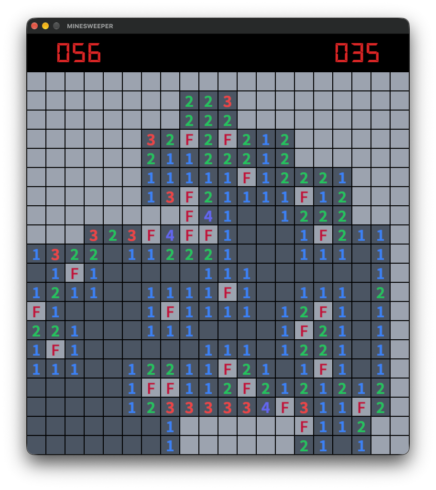

# bevy_minesweeper

[Bevy](https://bevy.org/)で作ったマインスイーパです。

> [!WARNING]
> 現在開発中です。予告なく仕様が変わることがあり，ゲームオーバーやゲームクリアの処理が未実装です。そのため，爆弾を踏むとクラッシュします。完成をお待ちください。


> [!NOTE]
> 画像は開発中のものです

## 遊び方
- 左クリック: マスを開く
- 右クリック: 旗を立てる / 外す
- 中クリック: マスを一括で開く(数字と周囲の旗の数が一致しているときのみ)

## 動作環境
- Rust (edition 2024 対応のツールチェーン。最新の stable 推奨)
- Windows / macOS / Linux
  - Linux では Bevy が必要とするシステムライブラリが別途必要です。Bevy 公式のセットアップ手順を参照してください。

## ビルドと実行

```bash
git clone https://github.com/janimaru0704/bevy_minesweeper.git
cd bevy_minesweeper

# 開発用ビルドで実行
cargo run

# 最適化ビルドで実行
cargo run --release
```

初回はBevyのビルドに時間がかかります。

### 補足

- `Cargo.toml`では，開発時のコンパイル時間を短縮するため Bevy の `dynamic_linking` を有効にしています。実行ファイルを配布する場合は，この feature を外してビルドしてください。
- Windows では `.carg/config.toml` で `rust-lld.exe` をリンカに指定しています。

## 使用ライブラリ

- [Bevy](https://bevy.org/) 0.20
- [rand](https://crates.io/crates/rand) 0.10

## ライセンス

- ソースコード: [Apache License 2.0](LICENSE)
- フォント (`assets/` 内):
  - [DSEG7 Modern Bold](https://www.keshikan.net/fonts.html): SIL Open Font License 1.1 ([DSEG-LICENSE.txt](DSEG-LICENSE.txt))
  - [Noto Sans JP](https://fonts.google.com/noto/specimen/Noto+Sans+JP): SIL Open Font License 1.1 ([NotoSans-LICENSE.txt](NotoSansJP-LICENSE.txt))

Copyright 2026 janimaru0704